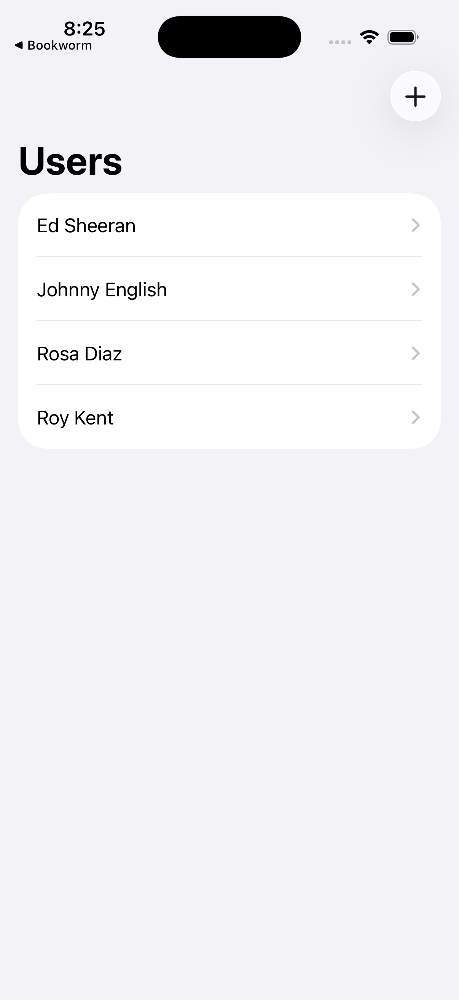
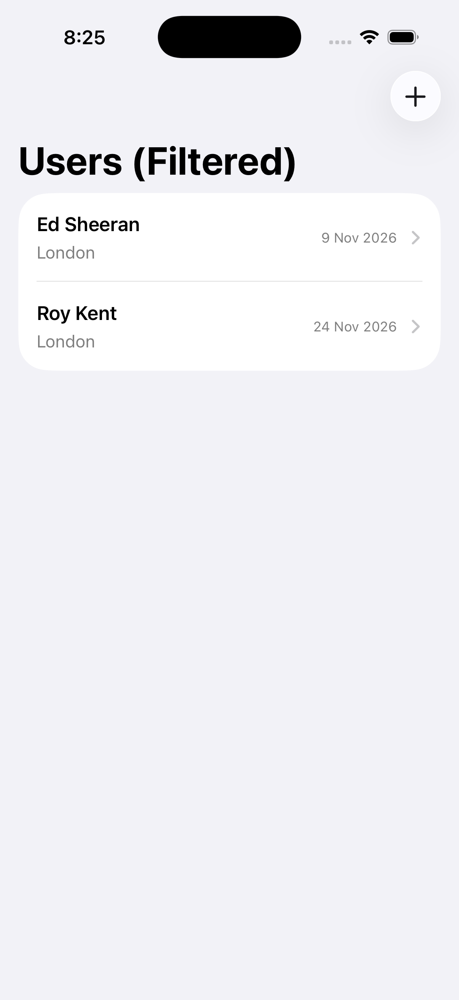
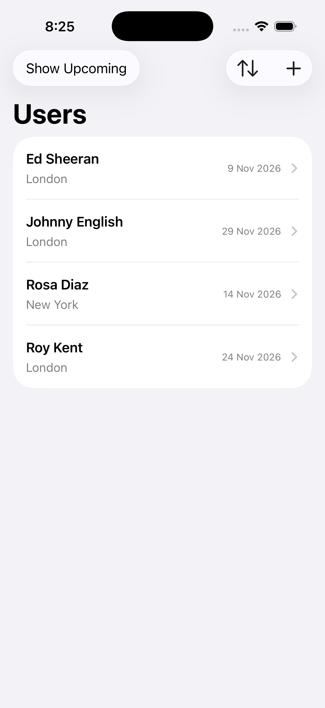

# SwiftDataProject 📦

An advanced SwiftUI & SwiftData exploratory application built as part of **Project 12 (Days 57–59)** in Paul Hudson's [100 Days of SwiftUI](https://www.hackingwithswift.com/100/swiftui).

This repository is organized into dedicated branches for each tutorial lesson, with code and visual verification screenshots for each step.

---

## 📱 Screenshots & Lessons Gallery

<p align="center">
  
  &nbsp;
  
  &nbsp;
  
  &nbsp;
  
</p>
<p align="center">
  <em>1. Editing Model Objects &nbsp;&bull;&nbsp; 2. Predicate Filtering &nbsp;&bull;&nbsp; 3. Dynamic Subview Queries &nbsp;&bull;&nbsp; 4. Model Relationships</em>
</p>

---

## 🌿 Branches Overview

| Branch | Topic | Key Concepts |
| :--- | :--- | :--- |
| **[`lesson-1-editing-swiftdata-model-objects`](https://github.com/selva7378/SwiftDataProject/tree/lesson-1-editing-swiftdata-model-objects)** | Editing Model Objects | `@Model`, `@Bindable`, `modelContainer`, in-place editing with `Form` |
| **[`lesson-2-filtering-query-using-predicate`](https://github.com/selva7378/SwiftDataProject/tree/lesson-2-filtering-query-using-predicate)** | Predicate Filtering | `#Predicate<T>`, `localizedStandardContains`, logical expressions |
| **[`lesson-3-dynamically-sorting-and-filtering`](https://github.com/selva7378/SwiftDataProject/tree/lesson-3-dynamically-sorting-and-filtering)** | Dynamic Query Manipulation | Custom subview (`UsersView`), `_users = Query(...)`, `SortDescriptor` arrays |
| **[`lesson-4-relationships-with-swiftdata`](https://github.com/selva7378/SwiftDataProject/tree/lesson-4-relationships-with-swiftdata)** | Model Relationships | `@Relationship(deleteRule: .cascade)`, one-to-many, automatic schema detection |

---

## 🛠️ Tech Stack & Requirements

- **iOS:** 17.0+
- **Frameworks:** SwiftUI, SwiftData, Foundation
- **Language:** Swift 5.9+ / Swift 6
- **IDE:** Xcode 15+ / 16+

---

## 🚀 How to Run

1. Clone the repository:
   ```bash
   git clone git@github.com:selva7378/SwiftDataProject.git
   cd SwiftDataProject
   ```
2. Switch to any branch to explore specific lesson code:
   ```bash
   git checkout lesson-1-editing-swiftdata-model-objects
   # or
   git checkout lesson-2-filtering-query-using-predicate
   # or
   git checkout lesson-3-dynamically-sorting-and-filtering
   # or
   git checkout lesson-4-relationships-with-swiftdata
   ```
3. Open `SwiftDataProject.xcodeproj` in Xcode and press `Cmd + R` to run on any simulator.

---

## 👤 Author

**Selva Ganesh**
- GitHub: [@selva7378](https://github.com/selva7378)
